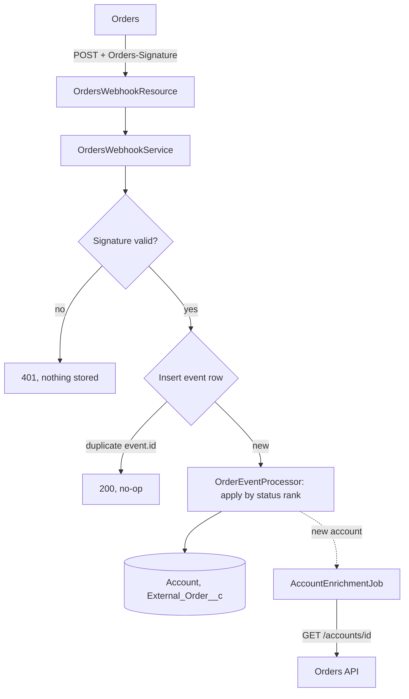
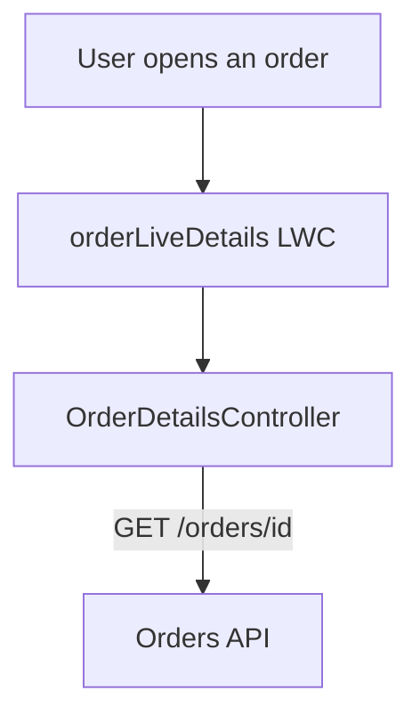

# Order Status: Salesforce Integration

Orders tells Salesforce whenever an order changes status, so the CX team can open an Account and see its orders right there. Status is stored in Salesforce. Amount, lines and participant are fetched from Orders when someone opens an order.

## What I built, and why

The ask was "all of the order data in Salesforce". I didn't copy all of it, and that was on purpose.

Events only carry IDs and the new status, and there's no `order.updated` event. If I stored an amount, nothing would tell me when it changed, and a copy you can't trust is worse than no copy. I also didn't want participant data sitting in the CRM without a good reason.

- **Stored:** order ID, friendly ID, status and when it changed, the account link, the account name, and every verified event.
- **Read live:** amount, lines and participant, with one call per order opened.

The price is that nobody can report on amount, or see it on the Account page's order list. That's the first thing I'd ask the CX lead about.

## Where it falls short

"My team never has to leave Salesforce" is only true once an order has had an event. Salesforce only learns about orders from events, and I don't call the list endpoint (`GET /accounts/{accountId}/orders`). So CX still has to go to Orders for:

- orders still in `created`, because there's no `order.created` event
- older orders that haven't had an event since go-live
- accounts that haven't had an event yet
- the real status of an order whose event was missed during a suspended subscription

That last one worries me most, because the stored status is wrong and nothing says so.

## What I'd build next

A nightly sync. I left it out to keep the exercise focused, so this is a design only: nothing here is built or tested.

Overnight, a job would walk every linked Account, fetch any missing name, list its orders and apply them. It would use the same status rank rule as events, so an old snapshot can't undo a newer event. Apex can't sleep, so to stay under the rate limit a Queueable would make about 50 calls, save its place and pick up again a minute later. That's about 20 minutes for 1,000 accounts.

It would also take over the account name lookup. The webhook would stop starting jobs, the public guest user would no longer need the Orders credential, and CX users would get the daytime rate limit to themselves.

Two things it wouldn't solve. A new account could show its friendly ID as its name for up to a day, unless a small hourly job fetches missing names. And with no endpoint listing all accounts, an account stays invisible until its first event, unless someone loads the IDs once.

The list response includes amount, so the sync could also store it for reporting, as "as of last night".

## How it works

There are two separate flows. The LWC never touches the webhook.

**Orders pushes status changes to Salesforce:**



**A user opens an order, and Salesforce reads the rest from Orders:**



## The decisions that matter

**The signature is the authentication.** The sender can't do OAuth, so the endpoint is a public Site, and the HMAC signature is checked before anything is parsed or stored. The guest user has no access to business data, so the webhook classes run in system mode explicitly.

**Status rank, not timestamps.** Statuses only move forward, so an event only counts if it ranks above the order's current status. Late events are kept for the timeline but change nothing. A global timestamp check would break on the sample data: `evt_003` is the oldest event, but it belongs to a different order and still has to apply.

**A unique index stops duplicates.** Every event is inserted with a unique `Event_Id__c`, so if the same event arrives twice, even at the same moment, only one insert succeeds.

**One bad event can't kill the feed.** The sender suspends the subscription after three failed retries. So once an event is verified and stored, I return 200 and keep any problem on my side: the row is marked `Failed` or `Unprocessable`, and failed rows can be replayed. A 500 only goes back when nothing was saved and a retry can help.

**Races are left to the sender's retry.** Two first events for a new order can arrive together. I first retried inside the transaction, and a concurrency test against the live Site showed that failing: the retry couldn't see the other transaction's uncommitted record, and Apex can't wait. So now it rolls back and returns a 500, and the redelivery succeeds.

**The rate limit only applies to my calls to Orders.** That's why events do the work rather than polling. Only two things call Orders: the account name lookup, once per new account, and the live panel, once per order opened. On a 429, the job waits as told and tries up to 3 times, and the panel tells the user how long to wait. Nothing counts calls or puts CX users first, so a burst of new accounts could show them "Orders is busy".

**I didn't use the standard `Order` object.** Its activation rules and pricebook requirements don't fit a read-only copy. `External_Order__c` is master-detail to Account, so it inherits Account sharing.

## Try it

You'll need a free [Developer Edition org](https://developer.salesforce.com/signup), the Salesforce CLI, and Node 18+ for the HTTP simulation.

```sh
sf org login web --alias orders --set-default
sf project deploy start --source-dir force-app
sf org assign permset --name Orders_CX_User
sf apex run --file scripts/apex/setup.apex
sf api request rest "/services/data/v68.0/named-credentials/credential" --method POST --body "@scripts/orders-credential.json"
```

The quickest test needs no Site. It sends the spec's five events through the real handler, then a tampered one:

```sh
sf apex run --file scripts/apex/simulateEvents.apex
```

In the `SIM` lines you should see five 200s, a 401 for the tampered event, `ord_77d1e9 = sent` and `ord_52ab10 = cleared`.

Then open the **Order Status** app, go to the Accounts tab and open `Northwind Plan Sponsor LLC`. Open an order to see the live panel and its events. Problems show up in the **Failed Events** list view on the Order Events tab, and on the **Integration Errors** tab.

To reset the sample data, run `scripts/apex/resetDemo.apex`. To re-run failed events, run `scripts/apex/replayFailedEvents.apex`.

If the order page shows only a few fields, assign `External Order Layout` under Object Manager > External Order > Page Layouts > Page Layout Assignment.

### Over real HTTP

The Site is org-specific, so it isn't in the source. In Setup, go to **Sites** and click **New**. Use Label `Orders Webhook` and Name `Orders_Webhook`, leave the path blank, tick **Active**, and pick any home page. Then give the guest user access:

```sh
sf data query --query "SELECT Username FROM User WHERE Name = 'Orders Webhook Site Guest User'"
sf org assign permset --name Orders_Webhook_Guest --on-behalf-of <that username>
```

Use the `salesforce-sites.com` host shown on the Site's page, because the `my.site.com` host returns `INVALID_SESSION_ID`.

```sh
node scripts/simulate/simulate-events.mjs https://<your-domain>.my.salesforce-sites.com
node scripts/simulate/simulate-events.mjs https://<your-domain>.my.salesforce-sites.com --tamper
node scripts/simulate/simulate-events.mjs https://<your-domain>.my.salesforce-sites.com --parallel
```

`--tamper` should get a 401. `--parallel` sends every event twice at once, so expect some 500s followed by 200s, plus a `Webhook contention` row for each 500.

The `Orders_API` Named Credential already points at a public Postman mock. To host your own, import [the collection](mock/orders-api.postman_collection.json), create a Mock Server, and put its URL plus `/v1` in the credential.

## What I tested

Apex tests cover the signature (including a value computed outside Salesforce), parsing, the rank rules, the failure paths, a 200-event batch and controller access. Tests weren't scored, so I wrote them where they protect behavior rather than for coverage.

Against the live Site, the sample sequence reached the right end state and a tampered body got a 401. Five `--parallel` rounds from clean all ended with the correct statuses, one Account and no failed events, with 3–5 contention 500s per round, all recovered by retry.

One thing I didn't solve: the slowest response in those rounds was 8.5 seconds, and an earlier run, before the contention fix, hit 11.9, over the sender's 10-second timeout. That's safe, because a timed-out delivery is retried and deduped, but I didn't find the cause. Lock waits on the parent Account are my first suspect.

## What else is missing

- Failures are recorded, but nobody gets alerted, and nothing would notice the feed going quiet.
- The secret is in a protected custom setting, which only really protects it inside a managed package. It also can't rotate yet.
- The 429 handling has only been tested with Apex mocks, because the Postman mock never returns one.
- Failed-event replay is all-or-nothing per batch. If one of the 200 events fails, the whole batch rolls back and stays marked Failed. A permanently bad event could block the others on subsequent replays. In production, I'd use all or none = false.
## Questions I would have asked

**For the product people**

1. **Do you want to report on things like money in orders, and at what level?** I assumed CX only needs to see it, so it's read on demand. If you do want reports, I'd bring that data into Salesforce instead of only reading it on demand. Order totals come with the list endpoint, but order lines would cost an extra call per order.
2. **If Orders is down, what would you rather see: possibly stale data, with a banner saying so, or no data at all?** I assumed no data: the panel shows an error instead of amount, lines and participant, and the stored status stays on the page. Showing stale data would mean storing those fields.
3. **Is it OK that orders only appear from `inProgress`?** I assumed so, because a new order gives CX little to act on.

**About the org**

4. **At peak, how many accounts and orders does the team open per minute?** Every order opened is one call to Orders, against a limit of 60 a minute, and I assumed the team is small enough that hitting it is rare. If account opens are low too, the Account page could discover orders live through the list endpoint, at one call per page of results, instead of waiting for a sync.
5. **How many accounts are there, and what's the most orders on one?** This sizes the reconciliation job: at least one call per account, so about 20 minutes per 1,000 accounts, plus a call for each extra page of 50 orders.
6. **Do Orders accounts map to existing Salesforce Accounts?** I assumed Orders is the master and created unknown accounts automatically. An existing Account with no link would become a duplicate, so a real rollout would load the IDs first.
7. **What event volumes should I expect, and is the rate limit shared with other systems?** I assumed modest volumes and a limit of our own. Large accounts could see more lock contention, which would be the reason to rethink master-detail.

**About Orders**

8. **Can amount or lines change after an order is created?** I assumed they can, and there's no `order.updated` event to signal it. If they can't, storing them is safe and most of the case for live reads goes away.
9. **Can a `returned` order ever be reissued?** I assumed not, and this is the riskiest assumption. If it can, the rank rule would hold the order at `returned` and mark the new event `Stale`, with no alert.
10. **Can missed events be replayed, and do we need a backfill?** I assumed forward-only for now. The nightly sync would cover both for accounts Salesforce already knows.
11. **Is `participantRef` regulated data?** I assumed it's sensitive, so it isn't stored.
