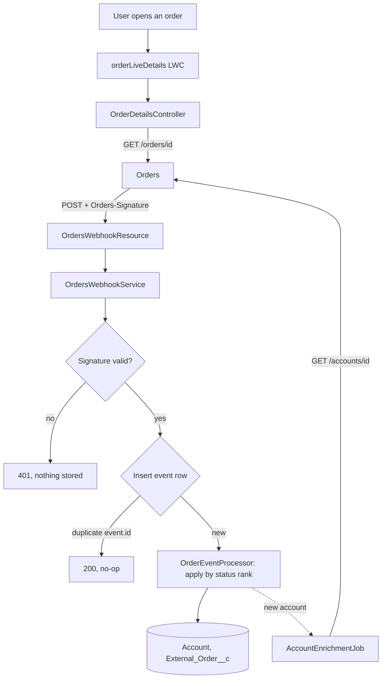

# Order Status: Salesforce Integration

Orders sends status events to a public Apex REST endpoint. Salesforce verifies each event, stores it once, and keeps a small read-only copy of each order, so a user can open an Account and see its orders and their status. Amount, lines and participant are read live from Orders when someone opens an order.

## The recommendation

The request was "all of the order data in Salesforce". I built what that request needs rather than a full copy.

Events carry only IDs and the new status. There is no `order.updated` event, so a stored amount, line or participant could go stale with nothing to signal it. A copy nobody can trust is worse than a live read. Fetching those fields on every event would also spend the 60 requests/minute limit and put financial and participant data in the CRM.

| Data | Where | Why |
|---|---|---|
| Order ID, friendly ID, status, status timestamp, account link | Stored on `External_Order__c` | Events keep it current. The Account page works even if Orders is down, and it can be reported on. |
| Account ID, friendly ID, name | Stored on `Account` | Needed to link orders to an Account. The name is fetched once, when the account is first seen. |
| Every verified event (IDs and type only) | Stored on `Order_Event__c` | Dedupe, audit trail, replay source and status timeline. |
| Amount, lines, participant | **Read live, never stored** | One call per order opened, always correct, no copy to secure. |

The CX team stays in Salesforce either way. The cost is that amount can't be reported on or shown on the related list, which is the first question I would have asked.

## How it works



| Class | Responsibility |
|---|---|
| `OrdersWebhookResource` | HTTP adapter: raw body and signature in, status code out. |
| `OrdersWebhookService` | The webhook's rules: verify, parse, claim, apply. No HTTP types, so anonymous Apex and tests can call it. |
| `OrdersSignature` | HMAC-SHA256 check over the raw bytes. |
| `OrderEventPayload` | Strict parsing and validation of the body. |
| `OrderStatuses` | Event type to status to rank. |
| `OrderEventProcessor` | Applies events to Accounts and orders. Takes a list of rows, so replay uses the same path as live delivery. |
| `OrdersApiClient` | The only class that calls Orders. Maps HTTP outcomes to typed errors. |
| `AccountEnrichmentJob` | Queueable that replaces a new Account's placeholder name. |
| `OrderDetailsController` | Live read for the LWC. Checks the user can see the order before calling out. |
| `IntegrationErrorLog` | Saves failures that have no event row to live on, as `Integration_Error__c` records. |

## Design decisions

**Public Site endpoint, not authenticated REST.** The spec's sender sends only `Content-Type` and `Orders-Signature`, with no OAuth token, so it couldn't call an authenticated endpoint. The HMAC signature is the authentication. It is checked before anything is parsed or stored. The guest user has access to the webhook class and the Orders credential, and no access to business data. The same class also answers at the authenticated `/services/apexrest` path.

**Out-of-order delivery: per-order status rank, not timestamps.** The spec lists statuses in order and says they never move backward, so an event only takes effect if it ranks above the order's current status. That needs no clock trust or tie-breaking. A global timestamp watermark would fail on the sample data: `evt_003` has the oldest timestamp, but it belongs to a different order and must still apply.

**Duplicates: a unique index, not check-then-insert.** Each event's insert into `Order_Event__c` relies on the unique `Event_Id__c`. Of two deliveries of one event, even concurrent ones, exactly one succeeds.

**Protecting the subscription.** The sender suspends the subscription after three failed retries, so one bad event must not take down the feed. Once an event is verified and stored, any failure is kept on the Salesforce side.

| Case | HTTP | Effect |
|---|---|---|
| Missing or bad signature | 401 | Nothing stored |
| Secret not configured | 500 | Fails closed |
| New, valid event | 200 | Row `Applied`, order updated |
| Duplicate `event.id` | 200 | No-op |
| Rank not above the current status | 200 | Row `Stale`, status unchanged, kept for the timeline |
| Signed but malformed, or unknown type | 200 | Row `Unprocessable`, raw body kept |
| Permanent failure applying the event | 200 | Rolled back, row `Failed` with the error, can be replayed |
| Concurrent contention (see below) | 500 | Everything rolled back, so the redelivery is processed normally. Logged as an Integration Error. |
| Event can't be stored at all | 500 | Nothing saved, so a retry is correct. Logged as an Integration Error. |

**Keeping errors visible.** `System.debug` only records anything while a trace flag is active, so failures with no event row are saved to `Integration_Error__c`: the two 500s above, and account enrichment failures, which otherwise leave a job showing "Completed". Rows are written after any rollback, or the rollback would remove them too, and a failure to log never changes the response. Two things still use `System.debug` only. A missing secret happens before the signature check, so a row per request would let anyone fill the org's storage. Live read failures are already shown to the user. A governor limit exception can't be caught, so that transaction logs nothing.

**Concurrency: the sender's retry resolves races.** Two first events for a new order can arrive together. The unique index lets one through and rejects the other, possibly while the winner is still uncommitted. I first retried inside the transaction, and a concurrency test against the live Site showed that failing: the retry couldn't yet see the winner's record, and Apex can't wait. So contention now rolls back and returns a 500, and the sender's retry with backoff handles it. A separate `FOR UPDATE` lock stops two events for one existing order overwriting each other.

**Standard `Order` not used.** It brings activation rules, status categories and pricebook requirements that don't fit a read-only mirror. `External_Order__c` is master-detail to Account, so it inherits Account sharing and is never owned by the guest user.

**Explicit system mode.** From API 67, Apex database operations default to user mode. The webhook runs as a guest with no business data access, so its classes declare system mode on every query and DML. `OrderDetailsController` does the opposite, with `WITH USER_MODE` and `with sharing`, because it acts for a real user and its callout isn't covered by Salesforce sharing.

**Secret storage.** The secret lives in a protected custom setting, set after deploy and never in metadata. That only gives real protection inside a managed package, so a production build should store it differently.

## Setup

**Prerequisites:** a free [Developer Edition org](https://developer.salesforce.com/signup), the Salesforce CLI, and Node 18+ for the HTTP simulation.

```sh
sf org login web --alias orders --set-default
sf project deploy start --source-dir force-app
sf org assign permset --name Orders_CX_User
sf apex run --file scripts/apex/setup.apex
sf api request rest "/services/data/v68.0/named-credentials/credential" --method POST --body "@scripts/orders-credential.json"
```

In order, the last three commands:
- give your admin user access to the Order Status app and its screens
- set the shared secret and the default record owner
- set the bearer token on the Orders credential (the mock accepts any non-empty value)

**To receive events over HTTP, create the Site.** It's org-specific, so it isn't in the source.

1. In Setup, go to **Sites**. Accept the terms if prompted.
2. Click **New**. Use Label `Orders Webhook` and Name `Orders_Webhook`, leave the path blank, tick **Active**, and pick any home page (e.g. `InMaintenance`). Save.
3. Give the guest user access:

```sh
sf data query --query "SELECT Username FROM User WHERE Name = 'Orders Webhook Site Guest User'"
sf org assign permset --name Orders_Webhook_Guest --on-behalf-of <that username>
```

The endpoint is `https://<your-domain>.my.salesforce-sites.com/services/apexrest/orders/events`. Use the `salesforce-sites.com` host shown on the Site's page. The `my.site.com` host returns `INVALID_SESSION_ID`.

**Orders mock (optional).** The `Orders_API` Named Credential already points at a public Postman mock serving the spec's samples. To host your own, import [mock/orders-api.postman_collection.json](mock/orders-api.postman_collection.json), create a Mock Server, and put its URL plus `/v1` in the Named Credential. If the mock is down, stored statuses keep working: Accounts keep their placeholder name and the live panel shows an error.

**If the order page's details section shows few fields,** assign `External Order Layout` under Object Manager > External Order > Page Layouts > Page Layout Assignment. Orgs in another language can auto-create a differently named default layout. The related lists are set on the record pages, so they aren't affected.

## Simulate events

**Anonymous Apex (no Site needed).** This sends the spec's five events through the real handler, then a tampered one:

```sh
sf apex run --file scripts/apex/simulateEvents.apex
```

Look for the `SIM` lines. Expected: five 200s, a 401 for the tampered event, `ord_77d1e9 = sent`, `ord_52ab10 = cleared`, one row for `evt_001`, and none for `evt_tampered`.

**Real HTTP, signed as Orders signs:**

```sh
node scripts/simulate/simulate-events.mjs https://<your-domain>.my.salesforce-sites.com
node scripts/simulate/simulate-events.mjs https://<your-domain>.my.salesforce-sites.com --tamper
node scripts/simulate/simulate-events.mjs https://<your-domain>.my.salesforce-sites.com --parallel
```

`--tamper` expects a 401. `--parallel` sends every event twice at once and retries as the sender does, so some 500s followed by 200s are expected.

**See the result:** in the App Launcher, open the **Order Status** app. On the Accounts tab, open `Northwind Plan Sponsor LLC` to see its orders, then open an order to see the live panel and its events.

| Script | Purpose |
|---|---|
| `scripts/apex/resetDemo.apex` | Removes the sample data, so you can run from clean |
| `scripts/apex/replayFailedEvents.apex` | Re-runs `Failed` events, up to 200 per run |

Failed and unprocessable events appear in the **Failed Events** list view on the Order Events tab. Other failures appear on the **Integration Errors** tab. After a `--parallel` run, expect `Webhook contention` rows there, one per 500. Those are expected, because the sender retries them.

## What I tested

- Apex tests cover the signature (including a value computed outside Salesforce), parsing, rank rules, the failure table, a 200-event batch with query and DML counts asserted, callout error mapping, enrichment and controller access. Tests weren't scored, so I wrote them where they protect behavior rather than for coverage.
- Against the live Site: the sample sequence reached the expected end state, and a tampered body got a 401.
- `--parallel` from a clean state, five rounds: every round ended with the correct statuses, one Account, and no failed events. Each round saw 3–5 contention 500s, all recovered by retry.
- A further `--parallel` run with error logging in place: 3 contention 500s produced exactly 3 `Integration_Error__c` rows, written by the guest user, which shows they survive the rollback.

**Known limit:** the slowest response in those five rounds was 8.5 seconds. An earlier run, before the contention fix, hit 11.9 seconds, over the sender's 10-second timeout. That is safe, because a timed-out delivery is retried and deduped, but I didn't find the cause. Lock waits on the parent Account are my first suspect. This traffic is deliberately worse than I'd expect in practice, but it's worth measuring against real volumes.

## Questions I would have asked

1. **What decisions does "all the data" need to support? Does CX need to report or filter on amount?**
   Assumed no: they need to see it, not report on it. That is what makes a live read viable. If they do need reporting, I would store amount and accept that it can only be kept fresh by polling.
2. **Can a `returned` order ever be reissued?**
   Assumed no: because the spec says statuses don't otherwise move backward. This is the most consequential assumption: if it's wrong, the rank rule would hold the order at `returned` and record the new event as `Stale`, with no alert. The event would be stored and recoverable, but the rule would need changing.
3. **Do Orders accounts map to existing Salesforce Accounts, and who owns that link?**
   Assumed Orders is the master, so an unknown account is created automatically and matched on `Orders_Account_Id__c`. An existing CRM Account with no link would become a duplicate. A real rollout would need the IDs loaded onto existing Accounts first.
4. **Can the sender authenticate with OAuth, or send from a fixed IP range?**
   Assumed neither, since the spec shows only the signature. That is why I chose a public Site. Either option would add a second layer of defense.
5. **Is there a way to replay events missed during a suspension? Is a historical backfill needed?**
   Assumed forward-only for now. The list endpoint could support reconciliation, though there is no endpoint listing all accounts, so it can only cover accounts Salesforce already knows.
6. **The spec lists a `created` status but no `order.created` event. Is it acceptable that orders appear only from `inProgress`?**
   Assumed yes, because a newly created order has little for CX to act on. If not, the Account page would need a live read of the list endpoint.
7. **Is `participantRef` regulated data, and what retention applies to stored events?**
   Assumed it should be treated as sensitive, so it isn't stored. Event rows hold only IDs and status, and are kept indefinitely for now.
8. **What are the expected volumes: events per minute, orders per account? Is the 60 requests/minute limit shared with other systems?**
   Assumed modest volumes and a dedicated limit. Large accounts could see more lock contention on the parent Account, which would be the reason to reconsider master-detail.
9. **How should the secret rotate, and is a replay window needed?**
   Assumed one secret and no window, because `event.id` dedupe already blocks replays of events we've stored. No timestamp is signed separately from the body. Rotation would need two valid secrets during the changeover.
10. **Does Orders ever send more than one event in a request?**
    Assumed no: the spec describes one event per POST. A signed batch would be parked as `Unprocessable` rather than lost.

## Deliberately left out

- **Reconciliation and backfill** through the paged list endpoint. This is the first thing I'd build, because it's the only way to recover from a suspended subscription.
- Scheduled retry of failed events, and alerting: failures are recorded, but nobody is notified.
- Per-row isolation in replay: one bad row fails its whole batch, which I accepted for a manual, post-incident script.
- Event retention purge, secret rotation, `subscriptionId` validation, and handling future event `version` values.
- Refreshing an Account's name after first sight (no event signals a change).
- Amount on the related list, and any UI polish.

## With more time

1. Build reconciliation, and alert when events fail or the feed goes quiet.
2. Find the cause of the slow responses under contention, then decide whether master-detail is still right for large accounts.
3. Move account enrichment out of the guest user's context, for example to a job running as an integration user, so that a public-facing user never needs credential access or makes outbound calls. Even more ideal would be to have a 
4. Replace the custom setting storing the raw signature with proper secret storage, and support rotation.
